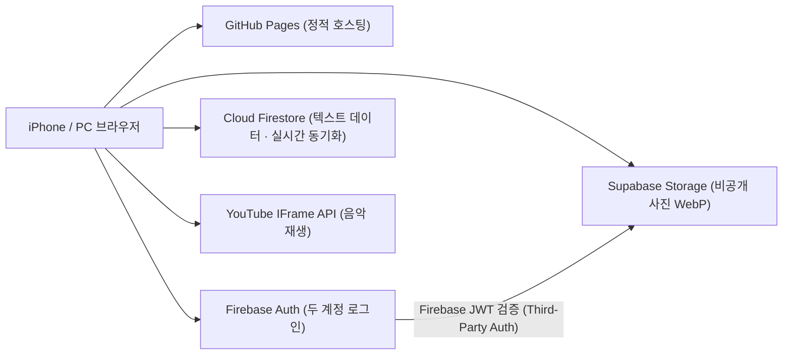

# 💑 ForBelle 기본 설계서 (Master Design Document)

> 문서 상태: 기본 설계 v2.0
> 최종 수정: 2026-10-17
> 역할: ForBelle 전체 방향·원칙·구조를 정의하는 **최상위 설계 문서**. 기능별 세부 구현은 하위 설계서를 따른다.

---

## 0. 문서 안내

### 0.1 이 문서의 역할

- 프로젝트의 목적, 사용자, 무료 인프라 원칙, 디자인·반응형·다국어 규칙을 한곳에 정의한다.
- 새 기능을 만들거나 기존 기능을 고칠 때 **가장 먼저 읽는 문서**다.
- 기능의 세부 체크리스트와 구현 기록은 아래 하위 설계서에 둔다.

### 0.2 문서 체계

| 문서 | 범위 | 상태 |
| :--- | :--- | :--- |
| `COUPLE_APP_SPEC.md` (이 문서) | 전체 기본 설계, 공통 원칙, 로드맵 | 기준 문서 |
| `ALBUM_SPEC.md` | 우리의 앨범 (Supabase 비공개 저장소) | 구현 완료, 실기기 검증 남음 |
| `CHAT_IMPROVEMENT_SPEC.md` | 상대에게 한마디 (실시간 채팅) | 구현 진행 |
| `CHARACTER_WORLD_SPEC.md` | 캐릭터 · 작은 정원 | 1차 구현, 게임형 확장 설계 예정 |
| `ARCHITECTURE.md` | 음악 싱크 가사 엔진 동작 원리 | 참고용 |
| `NEXT_AGENT_HANDOFF.md` | 작업 인수인계 메모 | 수시 갱신 |

> 원칙: **이 문서와 하위 문서가 충돌하면 이 문서의 공통 원칙을 우선**하고, 하위 문서를 고친다.

---

## 1. 프로젝트 개요

### 1.1 한 줄 정의

ForBelle은 **나와 여자친구(Belle) 단 두 사람만 사용하는 비공개 커플 웹앱**이다. 함께 듣는 노래, 대화, 다이어리, 사진, 귀여운 캐릭터 정원을 한곳에 담는다.

### 1.2 사용자

| 구분 | 내용 |
| :--- | :--- |
| 사용자 수 | 정확히 2명 (Firebase 계정 2개) |
| 주 사용 기기 | **iPhone Safari** (Belle), 스마트폰·PC (나) |
| 사용 언어 | 한국어 · 중국어 · 영어 (사용자별 선택) |
| 접속 방식 | 최초 1회 로그인 후 자동 로그인, 홈 화면 추가(PWA) 예정 |

### 1.3 핵심 원칙

1. **완전 무료**: 모든 인프라는 무료 플랜 한도 안에서 운영한다. 유료 전환이 필요한 기능은 설계 단계에서 제외하거나 대안을 찾는다.
2. **둘만의 공간**: 허용된 두 계정 외에는 어떤 데이터도 읽거나 쓸 수 없다.
3. **모바일 우선**: 모든 화면은 iPhone 390px 기준으로 먼저 설계하고 데스크톱으로 확장한다. (→ 5장)
4. **3개 언어 동시 지원**: 화면에 보이는 모든 문구는 한국어·중국어·영어를 함께 작성한다. (→ 6장)
5. **감성과 일관성**: 화면마다 따뜻한 아이보리·로즈 톤과 둥근 형태를 이어간다. (→ 4장)
6. **작고 확실하게**: 기능은 작게 완성해서 배포하고 다음 단계로 넘어간다. 기존 완성 기능을 깨뜨리지 않는다.

---

## 2. 인프라 및 기술 스택 (Free-Tier Architecture)

### 2.1 구성도



### 2.2 서비스별 역할과 무료 한도

| 서비스 | 역할 | 무료 한도 (요약) | 비고 |
| :--- | :--- | :--- | :--- |
| GitHub Pages | 웹앱 배포 (`main` 브랜치 `/docs`) | 정적 호스팅 무료 | `https://dohoonidot.github.io/forBelle/` |
| Firebase Authentication | 이메일/비밀번호 로그인 | 사실상 무제한 (2명) | 자동 로그인 세션 유지 |
| Cloud Firestore | 채팅, 다이어리, 신청곡, 프로필, 캐릭터, 앨범 메타데이터 | 저장 1GiB, 읽기 5만/일, 쓰기 2만/일 | 실시간 `onSnapshot` |
| Supabase Storage | 사진 파일 (앨범, 이후 다이어리·대표 사진) | 저장 1GB, 월 egress 5GB | 비공개 버킷 `couple-album` |
| YouTube IFrame API | 노래 재생 | 무료 | 음원 저장·스트리밍 비용 없음 |

> [!WARNING]
> **알려진 무료 플랜 리스크**
> - **Supabase 무료 프로젝트는 일정 기간(약 7일) 요청이 없으면 일시정지될 수 있다.** 둘이 자주 쓰면 문제없지만, 장기간 미사용 시 대시보드에서 재개해야 한다.
> - **Firebase Storage는 Spark(무료) 플랜에서 사용이 제한되도록 정책이 변경되었다.** 현재 프로필 사진 업로드(`avatars/`)가 Firebase Storage를 쓰므로 동작 확인 후 Supabase로 이전한다.
> - 앞으로 추가하는 모든 이미지 저장은 **Supabase Storage로 통일**한다.

### 2.3 이미지 압축 파이프라인 (공통)

앨범에서 완성한 파이프라인(`web/src/albumImage.ts`)을 **모든 이미지 업로드의 공통 모듈**로 재사용한다.

1. 입력: JPG/JPEG, PNG, WebP, **HEIC/HEIF**(iPhone, `heic2any`로 브라우저 변환)
2. 브라우저에서 리사이즈 + WebP 변환 (EXIF 방향 보정, 순차 처리로 iPhone 메모리 보호)
   - 표시용: 최대 2048px, 품질 82%
   - 썸네일: 최대 640px, 품질 76%
3. Supabase 비공개 버킷에 업로드 → Firestore에 경로와 메타데이터 저장
4. 표시할 때는 signed URL 발급

- 장당 약 350~800KB → 무료 1GB에서 **약 1,200~1,600장** 보관 가능
- 원본은 iCloud/휴대폰에 유지한다 (ForBelle은 원본 백업 서비스가 아님)

### 2.4 기술 스택

| 영역 | 사용 기술 |
| :--- | :--- |
| 프레임워크 | React 18 + TypeScript + Vite |
| 애니메이션 | Framer Motion, CSS transform |
| 에디터 | TipTap (StarterKit, Underline, Link, TaskList, Table, Image, Placeholder) |
| 아이콘 | Lucide React |
| 이미지 처리 | Canvas WebP 인코딩, `heic2any` |
| 데이터 | Firebase JS SDK (Auth, Firestore), Supabase JS (Storage) |

### 2.5 배포

- `web/`에서 `npm run build` → 결과물이 루트 `docs/`에 생성된다.
- 커밋과 푸시는 **사용자가 직접** 한다. 에이전트는 요청 없이 커밋·푸시하지 않는다.
- 공개 가능한 클라이언트 키(Firebase 웹 설정, Supabase publishable key)만 사용하고 `service_role` 키나 비밀번호는 절대 저장소에 넣지 않는다.

---

## 3. 정보 구조 (IA) 및 내비게이션

### 3.1 화면 목록

| 화면 (UI 이름) | 영어 / 중국어 | 내부 키 (`mode`) | 데이터 | 상태 |
| :--- | :--- | :--- | :--- | :--- |
| 홈 | Home / 主页 | `home` | (하드코딩 → `settings/couple` 예정) | ✅ 구현 |
| 우리의 노래 | Our Music / 我们的歌 | `viewer`, `editor` | `songs.ts`, VTT 정적 파일 | ✅ 구현 |
| 신청곡 | Song Request / 点歌 | `request` | `song_requests` | ✅ 구현 |
| 상대에게 한마디 | Sweet Messages / 对他说句话 | `message` | `messages` | ✅ 구현 |
| **둘만의 다이어리** | Our Diary / 我们俩的日记 | `topics` | `topics` | ✅ 구현 |
| 우리의 앨범 | Our Album / 我们的相册 | `album` | `album_photos` + Supabase | ✅ 구현 |
| **둘만의 정원** | Our Garden / 我们俩的花园 | `characters` | `couple_characters` | 🟡 1차 구현 · 2.5D 확장 설계 중 |
| 설정 | Settings / 设置 | (모달) | `profiles` | ✅ 구현 |

> [!NOTE]
> **"둘만의 다이어리"는 이전의 "오늘의 주제"다.** UI 이름만 바꾸고 내부 키(`mode: "topics"`, Firestore `topics` 컬렉션, CSS 클래스명)는 데이터 이전 없이 유지한다.

### 3.2 내비게이션 원칙

- 홈 화면의 **"둘만의 작은 세계" 카드 그리드**가 기본 진입점이다.
- 데스크톱: 왼쪽 사이드바(280px) + 본문.
- 모바일(≤768px): 사이드바는 햄버거 메뉴로 열리는 오버레이. 다이어리·앨범·채팅은 **전체 화면 전용 레이아웃**으로 전환하고, 상단에 홈 버튼을 둔다.
- 어느 화면에서든 **한 번의 탭으로 홈에 돌아갈 수 있어야** 한다.

---

## 4. 디자인 시스템

### 4.1 무드

> 따뜻한 아이보리 종이 위에 사진과 편지를 펼쳐 놓은 듯한, 차분하고 친밀한 분위기. 귀엽지만 유치하지 않게.

### 4.2 컬러 토큰 (현재 `styles.css` 기준)

| 토큰 | 값 | 용도 |
| :--- | :--- | :--- |
| `--bg-color` | `#FDFBF7` | 앱 배경 (웜 아이보리) |
| `--sidebar-bg` | `#F5EFE6` | 사이드바, 보조 면 |
| `--panel-bg` | `#FFFFFF` | 카드, 패널 |
| `--accent-color` | `#D4B996` | 기본 강조 (샌드 베이지) |
| `--accent-hover` | `#C5A075` | 강조 hover |
| `--text-primary` | `#4A4036` | 본문 텍스트 (웜 브라운) |
| `--text-secondary` | `#8C7E6A` | 보조 텍스트 |
| `--border-color` | `#E3D8C7` | 경계선 |
| 로즈 포인트 | `#B7786C`, `#A45F55`, `#E26D5C` | 하트, 저장됨, 활성 상태, 다이어리 여백선 |

- 캐릭터 대표 색: Belle **크림·로즈**, 나 **캐러멜·세이지** (`CHARACTER_WORLD_SPEC.md` 확정값)
- 다크 모드는 현재 범위에서 제외한다. 도입 시 `Night Navy #1A1A24` 계열을 기준으로 한다.

### 4.3 타이포그래피

| 용도 | 서체 |
| :--- | :--- |
| 제목 (`--font-heading`) | Gowun Dodum |
| 본문 (`--font-body`) | Noto Sans KR |
| 다이어리 본문 | Iowan Old Style / Palatino 계열 + Noto Sans KR (종이 느낌) |
| 중국어 | 시스템 폰트 대체 → **Noto Sans TC/SC 추가 검토** (6장 참고) |

### 4.4 형태와 컴포넌트 톤

- 기본 모서리 `16px`, 카드·시트 `22~28px`, 칩·배지는 pill(`999px`).
- 그림자는 연하고 따뜻하게 (`rgba(74, 64, 54, 0.08)` 계열).
- 모달은 모바일에서 **아래에서 올라오는 바텀 시트**(손잡이 바 포함), 데스크톱에서 가운데 카드.
- 빈 화면에는 귀여운 아이콘 + 한 줄 안내 문구를 둔다. 오류 문구는 탓하지 않고 다음 행동을 알려준다.

### 4.5 모션 원칙

- 화면 전환: Framer Motion 페이드 + 10~15px 이동, 0.3~0.5초.
- 마이크로 인터랙션: 하트 펄스, 탭 시 `scale(0.985)`, 저장 상태 아이콘 전환.
- 애니메이션은 `transform`·`opacity`만 사용해 iPhone에서 부드럽게 유지한다.
- `prefers-reduced-motion: reduce` 사용자는 이동·반복 애니메이션을 최소화한다.

---

## 5. 📱 반응형 및 모바일 UI/UX 원칙

> 이 장은 **모든 화면에 공통 적용되는 필수 규칙**이다. UI 작업은 이 기준을 통과해야 완료로 본다.

### 5.1 모바일 우선 (Mobile-first)

- 레이아웃은 **iPhone 390×844**를 기준으로 먼저 설계하고, 넓은 화면은 확장으로 다룬다.
- 데스크톱에서만 보기 좋은 레이아웃은 미완성으로 본다.

### 5.2 검증 해상도

| 구분 | 크기 | 대표 기기 |
| :--- | :--- | :--- |
| 최소 | 320×568 | iPhone SE 1세대 |
| 소형 | 375×667 | iPhone SE 2/3세대 |
| **기준** | **390×844** | iPhone 13/14/15 |
| 대형 | 430×932 | iPhone Pro Max / Plus |
| 데스크톱 | 1440×900 | 노트북 |

### 5.3 브레이크포인트

| 구간 | 기준 | 레이아웃 |
| :--- | :--- | :--- |
| 소형 모바일 | `≤ 480px` | 1열, 여백 축소, 글자 크기 한 단계 축소 |
| 모바일 | `≤ 768px` | 사이드바 숨김(오버레이), 전체 화면 전용 레이아웃 |
| 태블릿 · 데스크톱 | `> 768px` | 사이드바 + 본문 2단 |

- 캐릭터 화면 등 개별 화면은 필요 시 `640px`을 추가로 쓸 수 있다.
- 새 브레이크포인트는 꼭 필요할 때만 추가한다.

### 5.4 레이아웃 규칙

- **가로 스크롤(오버플로)은 어떤 해상도에서도 0**이어야 한다.
- 전체 높이는 `100vh` 다음 줄에 `100dvh`를 함께 선언해 Safari 주소창 변화에 대응한다.
- 노치·홈 인디케이터 영역은 `env(safe-area-inset-top/bottom)`으로 비켜간다. 고정 하단 바와 입력창은 반드시 적용한다.
- 고정 폭 대신 `min()`, `max()`, `clamp()`, `minmax(0, 1fr)`를 사용한다.
- 긴 텍스트는 `overflow-wrap: anywhere` 또는 말줄임으로 처리한다.

### 5.5 터치와 입력

- 모든 탭 대상은 **최소 44×44px**.
- `<input>`, `<textarea>` 글자 크기는 **16px 이상** (iOS 자동 확대 방지).
- **hover에만 의존하는 기능 금지.** hover로 보이는 버튼은 모바일에서 항상 보이거나 탭으로 열려야 한다.
- 길게 누르기(약 520ms)는 보조 동작(답장, 하트 등)에만 쓰고, 같은 기능을 다른 경로로도 제공한다.
- 드래그 앤 드롭, `Ctrl+V` 붙여넣기는 **데스크톱 전용 보조 기능**이다. 모바일에서는 버튼(사진 선택, 카메라)으로 같은 일을 할 수 있어야 한다.
- 탭 하이라이트는 제거하고(`-webkit-tap-highlight-color: transparent`) 자체 눌림 효과를 준다.

### 5.6 키보드 대응

- 채팅·다이어리처럼 입력이 많은 화면은 `visualViewport` 높이를 CSS 변수(예: `--chat-viewport-height`)로 반영해 **키보드가 올라와도 입력창과 툴바가 가려지지 않게** 한다.
- 입력 중에는 배경 스크롤을 잠그고(`overscroll-behavior: none`), 새 메시지는 아래로 자동 스크롤한다.
- 다이어리 툴바는 모바일에서 한 줄 가로 스크롤 형태의 콤팩트 툴바를 사용한다.

### 5.7 iPhone Safari 특이사항

- **HEIC/HEIF** 사진은 브라우저에서 변환 후 업로드한다.
- **자동 재생 정책**: YouTube는 `cueVideoById`로 준비만 하고 재생은 사용자 탭으로 시작한다.
- **PWA 독립 실행 모드**에서는 주소창이 없으므로 화면 안에 항상 홈·뒤로 가기 경로가 있어야 한다.
- 메모리 보호: 이미지 처리는 순차 실행하고 사용한 캔버스는 즉시 해제한다.

### 5.8 성능 기준

- 이미지는 썸네일 우선 로딩, 화면 밖 이미지는 지연 로딩.
- 무거운 화면(앨범 등)은 코드 분할(lazy import)한다.
- 화면이 백그라운드로 가면(`document.hidden`) 타이머와 애니메이션 루프를 멈춘다.
- 캐릭터 이미지는 개별 100KB 이하, 첫 화면 합계 1MB 이하.

### 5.9 화면별 모바일 기준

| 화면 | 모바일 기준 |
| :--- | :--- |
| 홈 | 히어로 사진 → D-Day → 카드 그리드 2열 → 다가오는 기능 목록 순서의 세로 흐름 |
| 우리의 노래 | 영상 16:9 전체 폭, 현재 가사 크게, 이전·다음 가사는 흐리게 |
| 상대에게 한마디 | 전체 화면 채팅, 하단 입력창 safe-area, 길게 눌러 액션 시트 |
| 둘만의 다이어리 | 전체 화면 편집기, 폴더 트리는 사이드바 오버레이, 노트 선택 시 자동 닫힘 |
| 우리의 앨범 | 썸네일 그리드 3열(모바일) / 4열(데스크톱), 전체 화면 스와이프 뷰어 |
| 캐릭터 · 정원 | 무대 영역은 화면 폭에 맞춘 비율 좌표, 조작 버튼은 엄지 닿는 하단 배치 |

### 5.10 검증 절차 (UI 작업 완료 조건)

1. 5.2의 해상도 5종에서 가로 오버플로 없음
2. 주요 버튼 44px 이상, 입력창 16px 이상
3. 키보드가 열린 상태에서 입력창·저장 버튼이 보임
4. 콘솔 오류 없음
5. 가능하면 **실제 iPhone Safari**에서 최종 확인 (자동 캡처에는 CJK 폰트가 없어 글자가 네모로 보일 수 있음)

---

## 6. 🌐 다국어 (i18n) 원칙

### 6.1 지원 언어

| 코드 | 언어 | 날짜 로케일 |
| :--- | :--- | :--- |
| `ko` | 한국어 (기본) | `ko-KR` |
| `zh` | 중국어 | `zh-TW` |
| `en` | 영어 | `en-US` |

- 언어는 설정에서 바꾸고 `profiles/{uid}.lang`과 `localStorage(belle_lang)`에 저장한다.

### 6.2 작성 규칙

- **화면에 보이는 모든 문구는 세 언어를 동시에 작성**한다. 한 언어만 있는 문구는 미완성이다.
- `App.tsx`: `tr(ko, en, zh)` 헬퍼 사용 (인자 순서 주의: **한국어, 영어, 중국어**).
- 분리된 컴포넌트(예: `CharacterWorld.tsx`): 파일 상단 `copy = { ko, en, zh }` 객체 사용.
- 시스템이 자동 생성하는 기본 데이터(예: 다이어리 기본 폴더 "둘만의 다이어리", "첫 노트")는 `defaultKey`로 식별하고, 언어 변경 시 이름을 함께 바꾼다.
- 영어 대문자 라벨(예: `OUR DIARY`)은 디자인 장식용이며, 중국어에서는 중국어로 번역한다.

### 6.3 확인이 필요한 사항

> [!IMPORTANT]
> 현재 중국어 문구는 **간체**(예: 我们俩的日记)로 작성되어 있지만 날짜 로케일은 **대만(`zh-TW`)**이다. Belle이 대만 번체에 익숙하다면 번체(예: 我們倆的日記)로 통일하는 것을 검토한다.

- 중국어 글자 일부가 Noto Sans KR에 없으면 시스템 폰트로 대체되어 굵기가 달라 보일 수 있다 → 필요 시 Noto Sans TC/SC를 폰트 목록에 추가한다.

---

## 7. 기능별 상세 설계

### 7.1 인증 및 프로필 — ✅ 구현

- Firebase 이메일/비밀번호 로그인. 허용된 두 계정만 사용한다.
- Firebase가 브라우저 세션을 복원할 때까지 기다린 뒤 로그인 화면 여부를 결정한다 (**자동 로그인**).
- 첫 로그인 시 온보딩: 닉네임, 언어, 프로필 사진.
- 계정 역할: `belle@…` → `belle`, 그 외 → `partner` (캐릭터·권한 판단에 사용).
- 남은 일: 프로필 사진 저장소를 Firebase Storage → Supabase로 이전 (2.2 참고).

### 7.2 홈: 대표 사진 · D-Day · 기념일 — 🟡 부분 구현

**현재**

- 대표 사진(부산 광안리), 캡션, 날짜가 코드에 고정되어 있다.
- 시작일 2025-09-23 기준 D+N 자동 계산.
- 100·200·300일, 1주년, 400·500일, 2주년 자동 계산 + 가장 가까운 기념일 ⭐ 강조.
- 사진 탭 시 전체 화면 라이트박스.

**예정: 우리답게 꾸미기**

- 대표 사진 변경 (모바일: 사진 위 📷 버튼 항상 표시, 데스크톱: hover 시 표시).
- 사진은 공통 압축 파이프라인 → Supabase `cover/` 경로에 저장.
- 시작일 변경, 커스텀 기념일 추가·삭제 (예: Belle 생일, 첫 해외여행).

```typescript
// Firestore: settings/couple
interface CoupleSettings {
  startDate: string;          // "2025-09-23"
  coverPhotoPath: string;     // Supabase 비공개 경로
  coverLocation: string;      // "부산 광안리 바다"
  coverDate: string;          // "2025-09-23"
  coverCaption: { ko: string; zh: string; en: string };
  customMilestones: Array<{
    id: string;
    name: { ko: string; zh: string; en: string };
    date: string;             // "YYYY-MM-DD"
    repeatYearly: boolean;    // 생일처럼 매년 반복
    icon?: string;
  }>;
  updatedAt: Timestamp;
}
```

### 7.3 우리의 노래 · 싱크 가사 — ✅ 구현

- YouTube IFrame API로 재생 (저작권·스트리밍 비용 없음).
- 약 0.15초마다 재생 시간을 확인해 대만어/한국어 가사를 강조 표시.
- Editor 모드: VTT/SRT 붙여넣기, 수동 탭 타이밍, 오프셋 조절, VTT/LRC 내보내기, 공유 링크.
- 상세 동작: `ARCHITECTURE.md`.
- 예정: 신청곡을 승인하면 "우리의 노래" 목록에 추가되는 흐름.

### 7.4 신청곡 — ✅ 구현

- YouTube 링크를 Firestore `song_requests`에 저장하고 목록·삭제를 제공한다.

### 7.5 상대에게 한마디 (실시간 채팅) — ✅ 구현

- Firestore `messages` 실시간 구독.
- 날짜 구분선, 읽음 표시, 답장, 하트 반응, 길게 눌러 액션 시트.
- iPhone 키보드 대응(`visualViewport`) 적용.
- 상세: `CHAT_IMPROVEMENT_SPEC.md`.
- 후보: 포스트잇/러브레터 형태의 "편지 모드", 감정 이모지 반응 확장.

### 7.6 둘만의 다이어리 (구 "오늘의 주제") — ✅ 구현 · 🟡 확장 예정

Obsidian처럼 **폴더와 노트를 트리로 관리하며 둘이 함께 쓰는 다이어리**.

**현재 구현**

- 폴더/노트 생성, 이름 변경, 이동, 삭제(하위 포함), 우클릭/길게 누르기 컨텍스트 메뉴 (화면 밖으로 나가지 않게 위치 보정).
- TipTap 리치 텍스트 편집 (제목, 목록, 체크리스트, 표, 링크, 밑줄).
- **자동 저장**: 입력 후 650ms 디바운스, 상태를 `dirty → saving → saved / error`로 표시, 실패 시 탭해서 재시도.
- 편집 중 실시간 스냅샷이 입력 내용을 덮어쓰지 않도록 보호. 화면 숨김·이탈·노트 전환 시 대기 중인 저장 마무리.
- 디자인: 아이보리 종이 + 붉은 세로 여백선 + 하트, 사이드바 브랜드 `FOR BELLE · OUR DIARY`.
- 첫 진입 시 기본 폴더 "둘만의 다이어리"와 "첫 노트" 자동 생성 (`defaultKey`로 언어별 이름 관리).

```typescript
// Firestore: topics/{id}  (컬렉션 이름은 호환을 위해 유지)
interface DiaryNode {
  name: string;
  type: "folder" | "file";
  parentId: string | null;
  content: string;            // TipTap HTML
  defaultKey?: "root_folder" | "root_note";
  createdBy: string;          // 이메일
  updatedAt: Timestamp;
}
```

**확장 예정**

| 우선순위 | 기능 | 메모 |
| :--- | :--- | :--- |
| 1 | 본문 사진 넣기 | 툴바 버튼(모바일 필수) + 드래그 앤 드롭·붙여넣기(데스크톱). 공통 압축 → Supabase `diary/{noteId}/` |
| 2 | 노트 검색 · 고정 · 즐겨찾기 | 제목·본문 검색 |
| 3 | 오늘의 질문 | 매일 질문 카드 1개, 각자 답을 쓰면 서로의 답이 열림 (홈의 "오늘, 우리에게 묻기"와 연결) |
| 4 | 작성자 표시 · 댓글 | 누가 쓴 노트인지, 하트와 짧은 코멘트 |

> [!NOTE]
> 다이어리 사진은 TipTap 본문에 **signed URL이 아니라 Supabase 경로**를 저장하고, 표시할 때 URL을 발급한다. signed URL은 만료되기 때문이다.

### 7.7 우리의 앨범 — ✅ 구현 (실기기 검증 남음)

- iPhone 다중 선택 업로드, HEIC 변환, WebP 압축(표시용 + 썸네일), Supabase 비공개 버킷 저장.
- 월별 타임라인, 앨범 태그 필터, 하트, 본인 사진 삭제, 전체 화면 스와이프 뷰어.
- 장당 350~800KB, **약 1,200~1,600장** 보관 목표.
- 상세: `ALBUM_SPEC.md`.

### 7.8 둘만의 정원 (구 "우리 캐릭터") — 🟡 1차 구현 · 🚀 2.5D 게임형 확장 설계 중

**현재 구현 (`CharacterWorld.tsx`)**

- UI 이름: **둘만의 정원** (`Our Garden` / `我们俩的花园`).
- 캐릭터: Belle = 아기 고양이 / 아기 토끼 (정원 상단 스위치 및 꾸미기 모달에서 즉시 전환 가능, 머리핀·진주 장식이 들어간 소녀 토끼 일러스트 적용), 나 = 아기 강아지 (캐러멜 털, 세이지 스카프).
- 본인 프로필 사진 등록: 설정 모달 및 둘만의 정원 프로필 꾸미기에서 사진(HEIC 포함)을 256×256 WebP로 압축해 Firestore(`profiles/{uid}`, `couple_characters/{role}`)와 로컬에 동기화.
- 이름·생일·한마디 편집, 정원 배경에서 두 캐릭터 자동 산책·휴식·잠자기·하트 교감, 생일 케이크 배지.

**확장 방향 (2.5D 탑다운 정원 & 역동적 캐릭터 동작 — 질답을 통해 구체화 중)**

> 약간 위에서 내려다보는 **2.5D 쿼터뷰/탑다운 정원** 안에서, 현재의 귀여운 고양이·토끼·강아지 디자인을 그대로 살리되 **살짝 입체적이고 역동적인 동작**을 추가하여 함께 교감하는 공간.

| 요소 | 내용 |
| :--- | :--- |
| 2.5D 정원 공간 | 위에서 살짝 내려다보는 아늑한 정원 시점 (깊이감 있는 Y축 이동, 그림자, 꽃밭·오솔길·벤치 등 오브젝트 앞뒤 배치) |
| 역동적인 동작 | 통통 튀는 걷기/달리기, 폴짝 점프, 귀 쫑긋/꼬리 흔들기, 뒹굴기, 간식 먹기, 서로 코 맞대기·안기기 |
| 실시간/비동기 교감 | 탭한 곳으로 걸어가기, 가까이 가면 하트·인사, 오프라인일 때도 정원에서 쉬거나 쪽지·선물 남기기 |

**무료로 구현하는 기술 방향**

| 데이터 성격 | 저장소 | 이유 |
| :--- | :--- | :--- |
| 실시간 위치, 접속 여부, 이모트 | **Firebase Realtime Database** (Spark 무료) | 작업 횟수가 아니라 용량 기준 과금, 지연이 짧음, 연결이 끊기면 자동으로 오프라인 처리(`onDisconnect`) |
| 정원 상태, 동물 수치, 인벤토리 | Cloud Firestore | 영구 데이터, 변경 시점에만 저장 |
| 성장·배고픔 | 서버 없이 **타임스탬프로 계산** | 예: `자란 정도 = (지금 - 심은 시각) / 성장 시간`. 유료인 Cloud Functions가 필요 없음 |

### 7.9 모바일 앱처럼 설치 (PWA) — ⏳ 예정

- 앱스토어 등록 없이 iPhone **"홈 화면에 추가"**로 앱 아이콘 생성 (개발자 계정 비용 0원).
- `manifest.json`: 이름 ForBelle, 아이콘(180·192·512px), 테마 색 `#FDFBF7`, `display: standalone`.
- iOS 전용: `apple-touch-icon`, `apple-mobile-web-app-capable`, 상태바 스타일.
- 독립 실행 모드에서 safe-area와 화면 안 내비게이션을 다시 확인한다 (5.7).

---

## 8. 데이터 모델 총괄

### 8.1 Cloud Firestore

| 컬렉션 / 문서 | 내용 | 사용 화면 |
| :--- | :--- | :--- |
| `profiles/{uid}` | 닉네임, 언어, 프로필 사진(압축 WebP Data URL), 온보딩 완료 여부 | 설정 · 채팅 · 둘만의 정원 |
| `messages/{id}` | 채팅 메시지, 읽음, 하트, 답장 | 상대에게 한마디 |
| `song_requests/{id}` | 신청곡 YouTube 링크 | 신청곡 |
| `topics/{id}` | 다이어리 폴더·노트 | 둘만의 다이어리 |
| `album_photos/{id}` | 사진 메타데이터 (경로, 크기, 날짜, 태그, 하트) | 우리의 앨범 |
| `couple_characters/{belle\|partner}` | 캐릭터 프로필 (종류, 이름, 생일, 한마디, 본인 사진) | 둘만의 정원 |
| `settings/couple` | 시작일, 대표 사진, 커스텀 기념일 | 홈 (예정) |

### 8.2 Supabase Storage (`couple-album`, Private)

```text
album/{uid}/{photoId}/display.webp     # 앨범 표시용 (구현)
album/{uid}/{photoId}/thumb.webp       # 앨범 썸네일 (구현)
cover/{photoId}.webp                   # 홈 대표 사진 (예정)
diary/{noteId}/{imageId}.webp          # 다이어리 본문 사진 (예정)
```

### 8.3 정적 파일 (GitHub Pages)

```text
web/public/characters/*.webp           # 캐릭터 이미지
web/public/images/                     # 기본 대표 사진 등
VTT / 가사 파일                         # 싱크 가사
```

---

## 9. 보안 및 개인정보

- Firestore 규칙과 Supabase Storage 정책 모두 **허용된 두 이메일만** 읽기·쓰기를 허용한다.
- 브라우저의 로컬 값(`localStorage`)만으로 데이터 접근을 허용하지 않는다. 항상 Firebase 인증 토큰으로 판단한다.
- 사진은 비공개 버킷 + signed URL로만 표시한다. 주소를 알아도 로그인하지 않으면 열 수 없다.
- 본인이 올린 사진만 삭제할 수 있다.
- 생일 등 개인정보는 공개 페이지·검색에 노출하지 않는다.
- 비밀키, 비밀번호, 토큰은 저장소·문서·로그에 남기지 않는다.

---

## 10. 품질 기준 (Definition of Done)

기능 하나를 "완료"로 표시하려면 아래를 모두 만족해야 한다.

- [ ] 한국어·중국어·영어 문구가 모두 있다
- [ ] 5.10 모바일 검증 절차를 통과했다
- [ ] 로딩·빈 상태·오류 상태 화면이 있다
- [ ] 실제 Firebase/Supabase에 저장되고, 새로고침 후에도 유지되는 것을 확인했다 (UI 표시만 보고 판단하지 않음)
- [ ] 두 계정 모두에서 동작을 확인했다
- [ ] TypeScript 검사와 `npm run build`가 통과한다
- [ ] 기존 기능(로그인, 채팅, 음악, 다이어리, 앨범, 캐릭터)에 문제가 생기지 않았다

---

## 11. 단계별 로드맵

| 단계 | 내용 | 상태 |
| :--- | :--- | :--- |
| **Phase 0** | 기반: 커플 홈 UI, 자동 로그인, 3개 언어, GitHub Pages 배포 | ✅ 완료 |
| **Phase 1** | 상대에게 한마디: 실시간 채팅, 읽음, 답장, 하트, iPhone 키보드 대응 | ✅ 완료 |
| **Phase 2** | 우리의 앨범: Supabase 비공개 저장, HEIC·WebP 압축, 타임라인, 스와이프 뷰어 | ✅ 코드 완료 · 실기기 검증 남음 |
| **Phase 3** | 둘만의 다이어리: 폴더·노트 트리, 자동 저장 안정화, 종이 테마 UI, 이름 변경 | ✅ 완료 |
| **Phase 4** | 둘만의 정원 1차: 캐릭터 3종(고양이·소녀 토끼·강아지), 본인 사진 연동, 자동 이동, 생일 배지 | ✅ 1차 완료 |
| **Phase 5** | 둘만의 정원 2.5D & 역동적 동작 확장: 탑다운 정원 공간, 다중 동작 애니메이션, 상호작용 | 🚀 설계 질답 진행 중 |
| **Phase 6** | 우리답게 꾸미기: `settings/couple`, 대표 사진·시작일·커스텀 기념일 | 준비 |
| **Phase 7** | 다이어리 확장: 본문 사진, 검색·고정, 오늘의 질문 | 준비 |
| **Phase 8** | PWA: 홈 화면 아이콘, 독립 실행 모드 최종 점검 | 마무리 |

---

## 12. 작업 규칙 요약

- 작업 전 이 문서와 관련 하위 설계서, 현재 코드를 함께 읽는다.
- UI를 바꾸면 데스크톱만 보지 말고 320/390/430px 모바일을 반드시 확인한다.
- 사용자 요청 없이 커밋·푸시하지 않는다.
- 기존 변경과 완성 기능을 임의로 삭제하거나 되돌리지 않는다.

---

## 부록 A. 용어집 (UI 이름 ↔ 코드)

| UI 이름 | 코드 / 데이터 키 | 비고 |
| :--- | :--- | :--- |
| 둘만의 다이어리 | `mode: "topics"`, `topics` 컬렉션, `.topics-*` CSS | 구 "오늘의 주제" |
| 상대에게 한마디 | `mode: "message"`, `messages` | |
| 우리의 앨범 | `mode: "album"`, `album_photos`, `couple-album` 버킷 | |
| 둘만의 정원 | `mode: "characters"`, `couple_characters` | 구 "우리 캐릭터" |
| 우리의 노래 | `mode: "viewer"` / `"editor"`, `songs.ts` | |
| 신청곡 | `mode: "request"`, `song_requests` | |
